# CLINIC — Déploiement Continu (CD)

## 1. Présentation du projet

Ce répertoire contient la configuration et les ressources nécessaires au déploiement continu (Continuous Deployment – CD) de l'application **CLINIC**, une application de gestion de cabinet dentaire.

L'objectif de cette partie est d'automatiser la récupération des images Docker publiées sur Docker Hub et leur déploiement sur l'environnement d'exécution à l'aide de **Jenkins et Docker Compose**.

Le mécanisme CD permet de mettre à jour automatiquement les services Backend et Frontend à partir des nouvelles images disponibles sur Docker Hub, sans reconstruire les images sur le serveur de déploiement.

La base de données PostgreSQL bénéficie d'un volume Docker nommé afin de garantir la conservation des données indépendamment du cycle de vie des conteneurs.

### Objectifs réalisés

- Conteneurisation de l'environnement de déploiement.
- Orchestration des services avec Docker Compose.
- Persistance des données PostgreSQL.
- Installation et configuration de Jenkins.
- Intégration de Jenkins avec le moteur Docker.
- Authentification sécurisée auprès de Docker Hub.
- Récupération automatisée des images Backend et Frontend.
- Redéploiement automatique des services.
- Vérification du fonctionnement du pipeline CD.
- Vérification de la persistance des données après redémarrage.

---

## 2. Architecture technique

L'environnement de déploiement repose sur quatre composants principaux :

| Composant | Technologie | Fonction |
|---|---|---|
| Base de données | PostgreSQL 16 | Stockage des données de l'application |
| Backend | Docker / FastAPI | Gestion de la logique métier et des API |
| Frontend | Docker / Nginx | Distribution de l'interface utilisateur |
| Automatisation CD | Jenkins | Automatisation du déploiement |

### Architecture de déploiement

```text
                  DOCKER HUB
                      |
          +-----------+-----------+
          |                       |
          v                       v
   dentarvd/backend:latest  dentarvd/frontend:latest
          |                       |
          +-----------+-----------+
                      |
                      v
                  JENKINS
                      |
             Authentification
                Docker Hub
                      |
                      v
             Récupération des images
                 docker pull
                      |
                      v
              Docker Compose
                      |
             Déploiement automatique
                      |
          +-----------+-----------+
          |           |           |
          v           v           v
       Backend    PostgreSQL   Frontend
        :8000       :5432        :80
          |           |           |
          +-----------+-----------+
                      |
                      v
              APPLICATION CLINIC
```

### Fonctionnement général

1. Les images Backend et Frontend sont publiées sur Docker Hub par les pipelines CI.
2. Jenkins s'authentifie auprès de Docker Hub grâce à un credential.
3. Jenkins récupère les dernières images publiées.
4. Docker Compose recrée les conteneurs concernés.
5. PostgreSQL conserve ses données grâce à son volume persistant.
6. Les services redémarrent et retrouvent leur état opérationnel.

---

## 3. Structure du répertoire

```text
deployment-cd/
│
├── docker-compose.yml
│
├── .env
│
├── Jenkinsfile
│
└── jenkins/
    ├── Dockerfile
    └── docker-compose
```

### Description des fichiers

| Fichier | Description |
|---|---|
| `docker-compose.yml` | Définition et orchestration des services CLINIC |
| `.env` | Variables d'environnement et paramètres sensibles |
| `Jenkinsfile` | Définition du pipeline CD |
| `jenkins/Dockerfile` | Personnalisation de l'image Jenkins |
| `jenkins/docker-compose` | Plugin Docker Compose installé dans Jenkins |

**Important :** le pipeline a été configuré dans la définition Pipeline Script du job Jenkins `CLINIC-CD`. Le fichier `Jenkinsfile` constitue également une copie de référence de cette configuration.

---

## 4. Prérequis techniques

L'environnement nécessite les outils suivants :

- Ubuntu Linux.
- Docker Engine.
- Docker Compose V2.
- Jenkins.
- Un compte Docker Hub.
- Les images Backend et Frontend publiées sur Docker Hub.

### Versions utilisées lors de la réalisation

| Outil | Version |
|---|---|
| Docker Engine | 29.9.2 |
| Docker Compose | 5.7.0 |
| Jenkins | 2.541.2 |
| Java | 21 |
| PostgreSQL | 16 Alpine |
| Docker CLI dans Jenkins | 26.1.5 |

Les versions indiquées correspondent à l'environnement utilisé pendant la réalisation du projet.

---

## 5. Configuration Docker Compose

Le fichier `docker-compose.yml` définit trois services :

### 5.1. Service PostgreSQL

```yaml
db:
  image: postgres:16-alpine
  restart: unless-stopped
  environment:
    POSTGRES_DB: ${POSTGRES_DB}
    POSTGRES_USER: ${POSTGRES_USER}
    POSTGRES_PASSWORD: ${POSTGRES_PASSWORD}
  volumes:
    - clinic_postgres_data:/var/lib/postgresql/data
  healthcheck:
    test: ["CMD-SHELL", "pg_isready -U $${POSTGRES_USER} -d $${POSTGRES_DB}"]
    interval: 10s
    timeout: 5s
    retries: 5
    start_period: 15s
```

PostgreSQL assure le stockage des données de l'application.

Un volume Docker nommé `clinic_postgres_data` est associé au répertoire de données PostgreSQL.

Ce mécanisme permet de conserver les données même lorsque les conteneurs sont arrêtés ou recréés.

Le healthcheck permet également de vérifier que PostgreSQL est prêt à accepter les connexions.

### 5.2. Service Backend

```yaml
backend:
  image: dentarvd/backend:latest
  restart: unless-stopped
  env_file:
    - .env
  depends_on:
    db:
      condition: service_healthy
  expose:
    - "8000"
```

Le Backend utilise l'image publiée sur Docker Hub.

Il communique avec PostgreSQL à travers le réseau interne Docker.

Le service dépend de PostgreSQL et attend que celui-ci soit déclaré opérationnel avant son démarrage.

Le port 8000 est exposé uniquement au réseau interne Docker.

### 5.3. Service Frontend

```yaml
frontend:
  image: dentarvd/frontend:latest
  restart: unless-stopped
  ports:
    - "80:80"
  depends_on:
    backend:
      condition: service_healthy
```

Le Frontend utilise Nginx pour distribuer l'application.

Le port 80 du conteneur est publié sur le port 80 de la machine hôte.

Le démarrage du Frontend dépend de la disponibilité du Backend.

### 5.4. Volume PostgreSQL

```yaml
volumes:
  clinic_postgres_data:
```

Ce volume garantit la conservation des données PostgreSQL indépendamment du cycle de vie des conteneurs.

---

## 6. Configuration des variables d'environnement

Le fichier `.env` contient les paramètres nécessaires au fonctionnement des services. Il est créé directement sur le serveur de déploiement et n'est pas versionné. Copiez `.env.example` vers `.env`, puis renseignez les valeurs propres à votre environnement.

Exemple de structure :

```env
POSTGRES_DB=clinic
POSTGRES_USER=clinic_user
POSTGRES_PASSWORD=remplacer_par_un_mot_de_passe_fort

DATABASE_URL=postgresql+psycopg2://clinic_user:remplacer_par_un_mot_de_passe_fort@db:5432/clinic

ADMIN_IDENTIFIANT=admin
ADMIN_PASSWORD=remplacer_par_un_mot_de_passe_admin

DEMO_PASSWORD=remplacer_par_un_mot_de_passe_demo

JWT_SECRET=remplacer_par_une_cle_aleatoire_longue
JWT_EXPIRE_MINUTES=480

CORS_ORIGINS=http://localhost
```

Les valeurs présentées sont des exemples de configuration. Elles doivent être adaptées à l'environnement.

### Précautions de sécurité

- Ne jamais publier le fichier `.env` sur GitHub.
- Ne jamais intégrer les mots de passe directement dans les fichiers de configuration versionnés.
- Utiliser des mots de passe robustes.
- Protéger les fichiers contenant des informations sensibles.

Exemple :

```bash
chmod 600 .env
```

---

## 7. Installation et configuration de Jenkins

Jenkins est utilisé pour exécuter automatiquement les opérations de déploiement.

Une image Docker personnalisée a été construite à partir de l'image `jenkins-with-docker:latest`.

Cette personnalisation permet notamment :

- D'intégrer le client Docker.
- D'intégrer le plugin Docker Compose.
- De configurer le groupe permettant l'accès au socket Docker de l'hôte.

### 7.1. Construction de l'image Jenkins personnalisée

L'image construite est :

```text
dentarvd/jenkins-cd:1.0
```

Commande de construction :

```bash
docker build -t dentarvd/jenkins-cd:1.0 ./jenkins
```

### 7.2. Démarrage de Jenkins

Jenkins est exécuté dans un conteneur Docker.

```bash
docker run -d \
  --name dentardv-jenkins \
  --restart unless-stopped \
  --group-add 983 \
  -p 8080:8080 \
  -v jenkins_home:/var/jenkins_home \
  -v /var/run/docker.sock:/var/run/docker.sock \
  -v "$(pwd):/opt/dentardv/deployment-cd:ro" \
  dentardv/jenkins-cd:1.0
```

### 7.3. Explication des montages

| Montage | Fonction |
|---|---|
| `jenkins_home` | Persistance de la configuration Jenkins et des plugins |
| `/var/run/docker.sock` | Communication avec le moteur Docker de l'hôte |
| `/opt/dentardv/deployment-cd` | Accès aux fichiers de déploiement |

Le groupe supplémentaire `983` correspond au GID du groupe Docker de la machine hôte.

Le répertoire CD est monté en lecture seule dans Jenkins afin de limiter les modifications accidentelles.

### 7.4. Accès à Jenkins

Interface Web :

```text
http://localhost:8080
```

Jenkins permet de gérer les pipelines, les credentials et les historiques de déploiement.

---

## 8. Configuration du credential Docker Hub

Pour permettre à Jenkins de télécharger les images privées ou authentifiées sur Docker Hub, un credential a été créé.

Dans Jenkins :

1. Accéder à **Administrer Jenkins**.
2. Ouvrir la gestion des credentials.
3. Sélectionner le domaine approprié.
4. Ajouter un nouveau credential.
5. Choisir le type **Username with password**.
6. Renseigner le nom d'utilisateur Docker Hub.
7. Renseigner le Docker Hub Access Token.
8. Définir l'identifiant suivant :

```text
dockerhub-credentials
```

Ce credential est utilisé dans le pipeline grâce à l'instruction `withCredentials`.

Les informations d'authentification ne sont donc pas écrites directement dans le Jenkinsfile.

---

## 9. Pipeline Jenkins CD

Le pipeline est responsable de la récupération et du déploiement des nouvelles images Docker.

### 9.1. Étapes du pipeline

Le pipeline comporte trois étapes principales.

**Étape 1 : Authentification Docker Hub**

Jenkins utilise le credential `dockerhub-credentials` pour ouvrir une session auprès de Docker Hub.

**Étape 2 : Récupération des images**

Les images Backend et Frontend sont téléchargées :

```bash
docker compose \
  -p deployment-cd \
  -f /opt/dentardv/deployment-cd/docker-compose.yml \
  --env-file /opt/dentardv/deployment-cd/.env \
  pull backend frontend
```

**Étape 3 : Déploiement automatique**

Docker Compose applique les nouvelles images :

```bash
docker compose \
  -p deployment-cd \
  -f /opt/dentardv/deployment-cd/docker-compose.yml \
  --env-file /opt/dentardv/deployment-cd/.env \
  up -d --no-build --remove-orphans
```

L'option `--no-build` indique que les images ne sont pas reconstruites localement.

L'option `--remove-orphans` permet de supprimer les conteneurs orphelins associés au projet Compose.

### 9.2. Fonctionnement global

```text
Déclenchement du job CLINIC-CD
              |
              v
Authentification Docker Hub
              |
              v
Récupération des images
              |
              v
Déploiement Docker Compose
              |
              v
Recréation des conteneurs
              |
              v
Fin du pipeline
              |
       +------+------+
       |             |
       v             v
    SUCCESS        FAILURE
```

Le job `CLINIC-CD` est déclenché automatiquement par la scrutation périodique SCM configurée dans Jenkins. Jenkins vérifie le dépôt GitHub et lance le pipeline lorsqu'un nouveau commit est détecté sur la branche surveillée. Le pipeline récupère alors les images publiées sur Docker Hub et redéploie les services.

---

## 10. Procédure de déploiement

### 10.1. Démarrage manuel de l'environnement

Depuis le répertoire `deployment-cd` :

```bash
docker compose up -d
```

### 10.2. Vérification des conteneurs

```bash
docker compose ps
```

### 10.3. Consultation des journaux

Backend :

```bash
docker compose logs -f backend
```

Frontend :

```bash
docker compose logs -f frontend
```

PostgreSQL :

```bash
docker compose logs -f db
```

### 10.4. Déploiement automatique depuis Jenkins

Après un commit sur la branche surveillée, Jenkins détecte automatiquement le changement et exécute `CLINIC-CD`. Pour suivre le déploiement, ouvrir le job dans Jenkins, sélectionner le build correspondant et consulter **Console Output**.

Le résultat attendu est :

```text
Login Succeeded

Image dentarvd/backend:latest Pulled
Image dentarvd/frontend:latest Pulled

Container deployment-cd-backend-1 Recreated
Container deployment-cd-frontend-1 Recreated

SUCCESS : CLINIC deploye avec les nouvelles images Docker Hub.

Finished: SUCCESS
```

---

## 11. Vérifications et validation du déploiement

Plusieurs vérifications ont été réalisées pour confirmer le bon fonctionnement de l'environnement.

### 11.1. Vérification des services

Commande :

```bash
docker compose ps
```

Résultats obtenus :

| Service | Image | État |
|---|---|---|
| PostgreSQL | postgres:16-alpine | Healthy |
| Backend | dentarvd/backend:latest | Healthy |
| Frontend | dentarvd/frontend:latest | Healthy |

### 11.2. Vérification du Frontend

```bash
curl -I http://localhost
```

Résultat obtenu :

```text
HTTP/1.1 200 OK
Server: nginx/1.30.6
```

Le Frontend répond correctement aux requêtes HTTP.

### 11.3. Vérification du Backend

```bash
curl -i http://localhost/api/health
```

Résultat obtenu :

```json
{
  "status": "ok"
}
```

Le Backend répond correctement à la requête de santé.

### 11.4. Vérification de la persistance PostgreSQL

Un test spécifique a été effectué pour vérifier la conservation des données après redémarrage des conteneurs.

**Première opération : insertion d'une donnée de test**

```sql
INSERT INTO soin (libelle)
VALUES ('TEST_PERSISTANCE_CD_2026')
RETURNING id, libelle;
```

Résultat :

```text
 id |         libelle
----+--------------------------
  7 | TEST_PERSISTANCE_CD_2026
```

**Deuxième opération : redémarrage des conteneurs**

```bash
docker compose restart
```

Après redémarrage, PostgreSQL a retrouvé son état `healthy`.

**Troisième opération : vérification de la donnée**

```sql
SELECT *
FROM soin
WHERE libelle = 'TEST_PERSISTANCE_CD_2026';
```

Résultat obtenu :

```text
 id |         libelle
----+--------------------------
  7 | TEST_PERSISTANCE_CD_2026
(1 row)
```

**Conclusion :**

La donnée insérée avant le redémarrage est toujours présente après le redémarrage des conteneurs.

La persistance PostgreSQL est donc validée.

### 11.5. Disponibilité pendant le redéploiement

Pendant l'exécution du pipeline Jenkins, une requête répétée a été envoyée à l'endpoint de santé du Backend :

```bash
while true; do
  printf '%s ' "$(date '+%H:%M:%S')"
  curl -s -o /dev/null -w 'HTTP %{http_code} - %{time_total}s\n' \
    http://localhost/api/health
  sleep 1
done
```

Les réponses `HTTP 200` visibles pendant le redéploiement indiquent que l'endpoint est resté accessible pendant la période observée. Cette vérification illustre la disponibilité du service lors de cette exécution ; elle ne constitue pas une garantie générale d'absence d'interruption pour tous les déploiements.

---

## 12. Résultats du pipeline CD

Le premier déploiement automatisé a été exécuté avec succès depuis Jenkins.

Résultat final :

```text
Started by user admin

Authentification Docker Hub
    SUCCESS

Récupération des images
    SUCCESS

Déploiement automatique
    SUCCESS

Déconnexion Docker Hub
    SUCCESS

Finished: SUCCESS
```

### Bilan des réalisations

| Fonctionnalité | Statut |
|---|---|
| Configuration Docker Compose | VALIDÉ |
| Déploiement PostgreSQL | VALIDÉ |
| Déploiement Backend | VALIDÉ |
| Déploiement Frontend | VALIDÉ |
| Persistance PostgreSQL | VALIDÉ |
| Installation de Jenkins | VALIDÉ |
| Connexion Jenkins / Docker | VALIDÉ |
| Installation de Docker Compose dans Jenkins | VALIDÉ |
| Credential Docker Hub | VALIDÉ |
| Création du pipeline CD | VALIDÉ |
| Récupération automatique des images | VALIDÉ |
| Redéploiement automatique | VALIDÉ |
| Exécution réussie du pipeline | VALIDÉ |
| Test de persistance après redémarrage | VALIDÉ |
| Disponibilité observée pendant le redéploiement | VALIDÉ |

### 12.1 Captures d'écran

Les captures ci-dessous documentent la configuration et les vérifications réalisées pour le déploiement continu.

| Capture | Élément illustré |
|---|---|
#### 1. Environnement Docker Compose

Définition des services et de l'environnement Docker Compose.

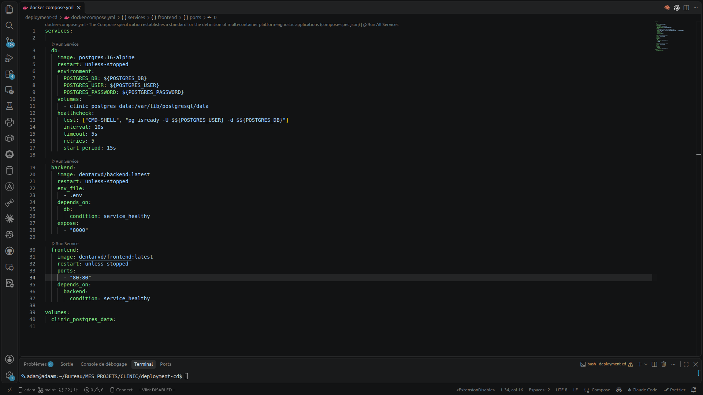

#### 2. Services actifs

État des services déployés avec Docker Compose.

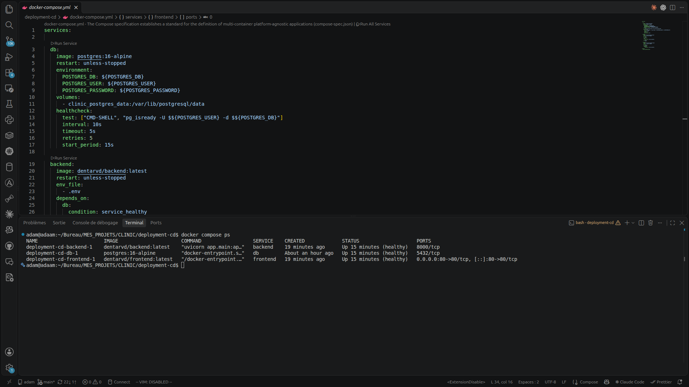

#### 3. Persistance PostgreSQL

Vérification de la conservation des données PostgreSQL.


#### 4. Jenkins installé

Installation et démarrage de Jenkins.

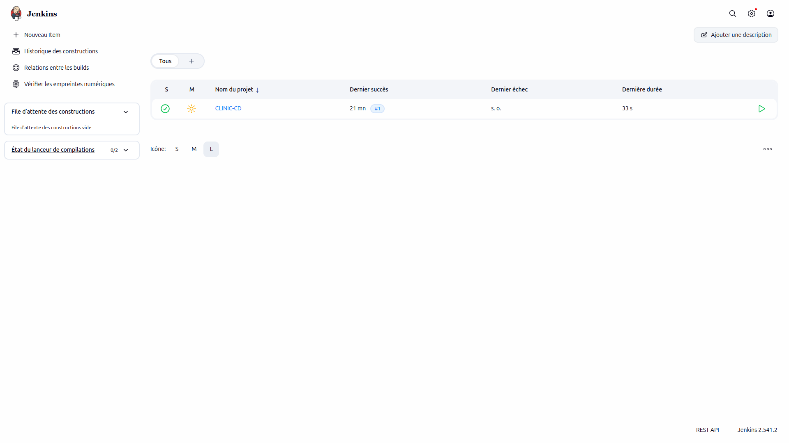

#### 5. Jenkins connecté à Docker

Connexion de Jenkins au moteur Docker.

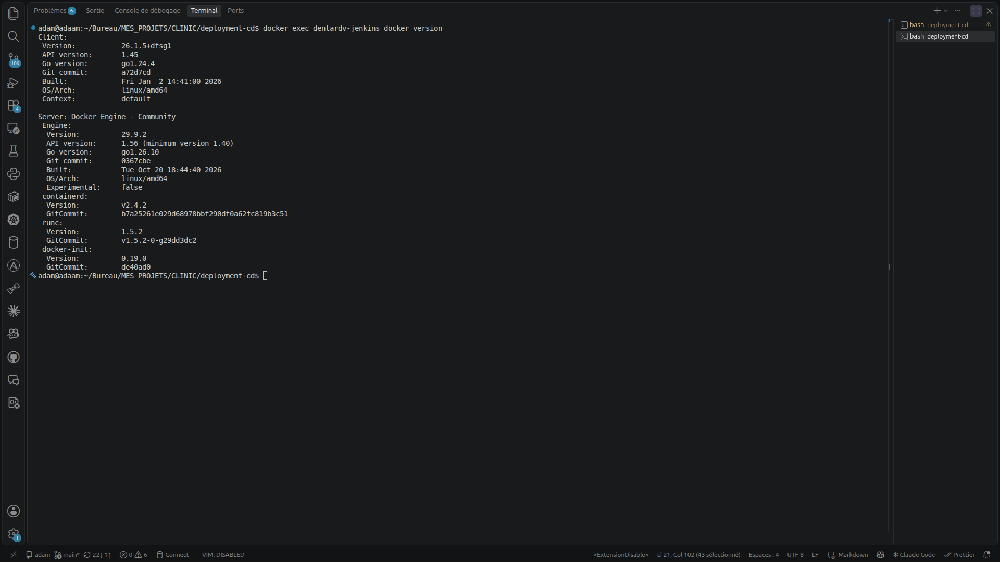

#### 6. Docker Compose dans Jenkins

Disponibilité de Docker Compose dans l'environnement Jenkins.

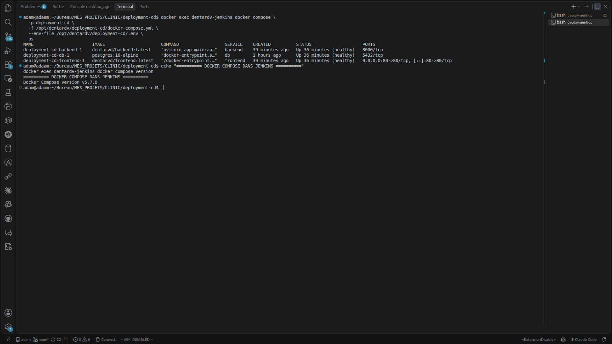

#### 7. Credential Docker Hub

Configuration du credential Docker Hub.

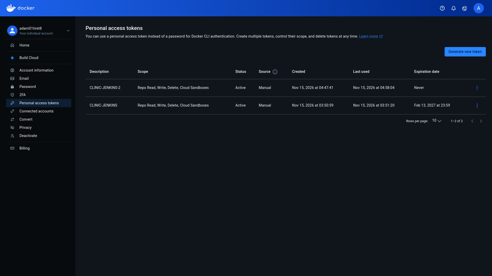

#### 8. Job pipeline

Création et configuration du pipeline `CLINIC-CD`.

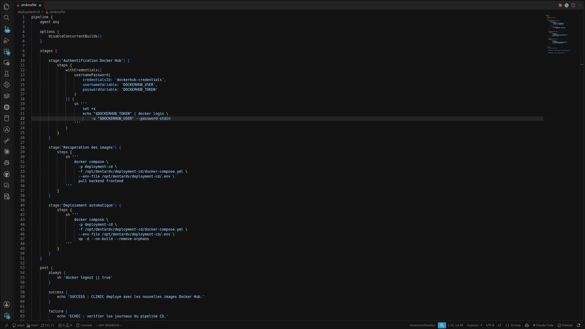

#### 9. Récupération des images

Récupération des images Docker Hub par le pipeline.

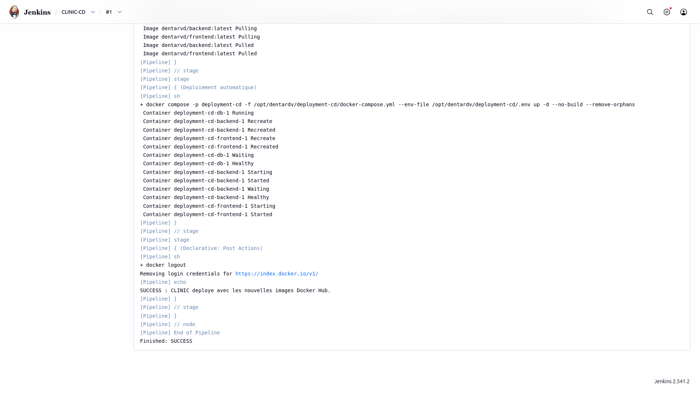

#### 10. Redéploiement

Redéploiement des services par le pipeline Jenkins.

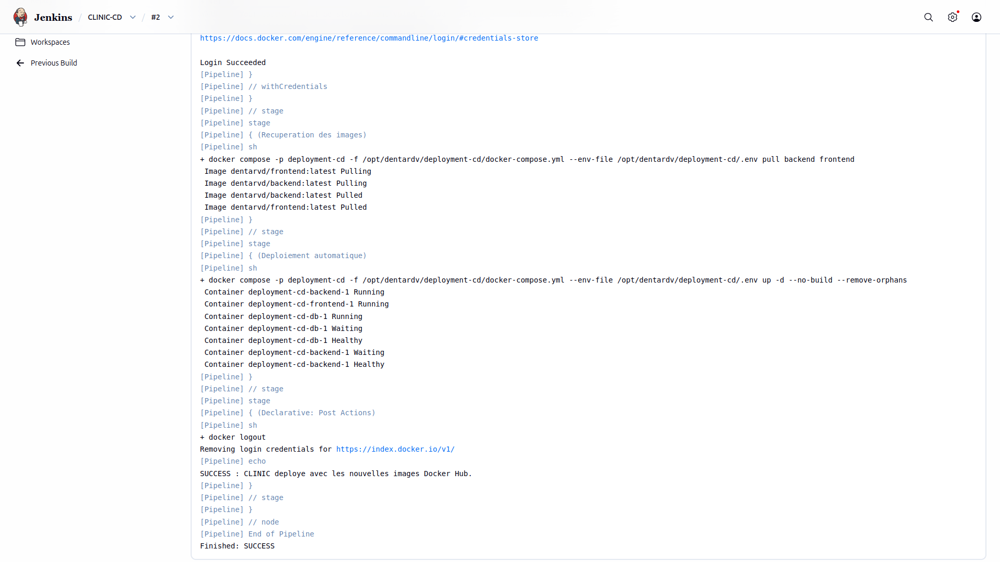

#### 11. Disponibilité pendant le redéploiement

Les requêtes de santé du Backend continuent de renvoyer `HTTP 200` pendant l'exécution du pipeline affiché.

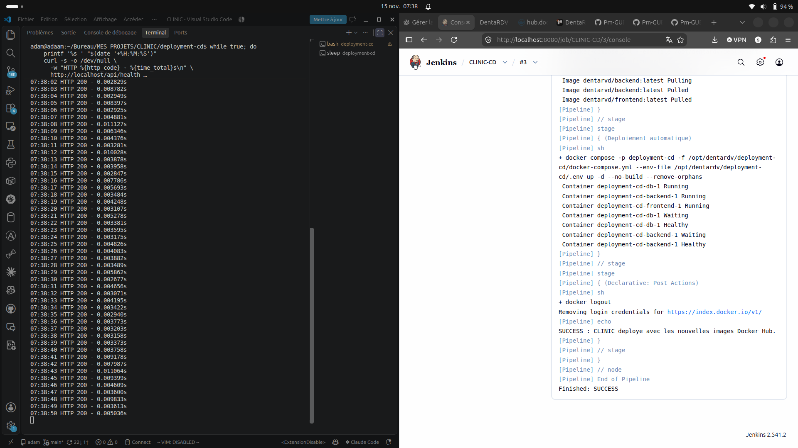

#### 12. Déclencheur SCM

La scrutation périodique du dépôt Git déclenche automatiquement le pipeline lorsqu'un changement est détecté.

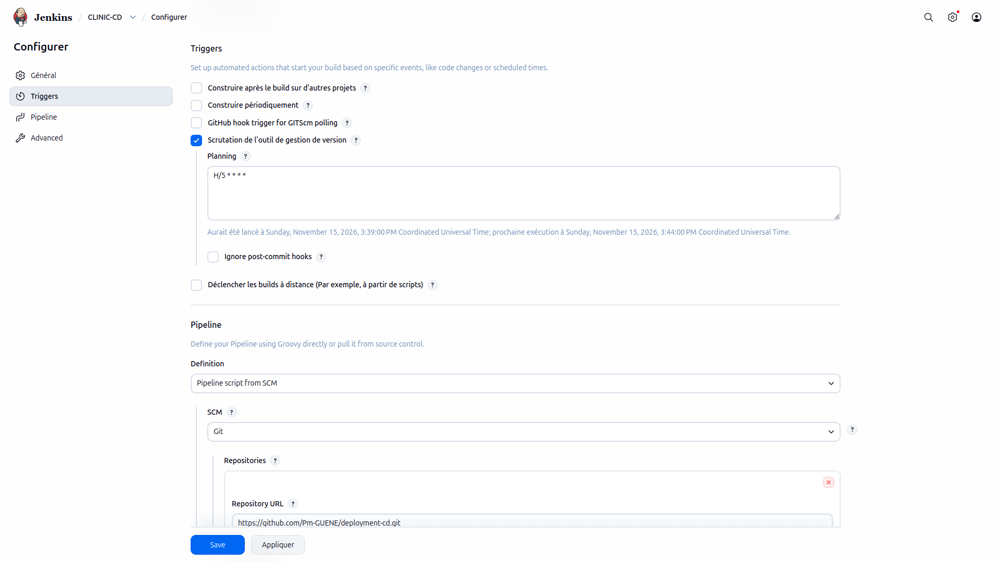

#### 13. Pipeline relié au dépôt Git

Configuration du pipeline Jenkins pour récupérer le `Jenkinsfile` depuis le dépôt GitHub.

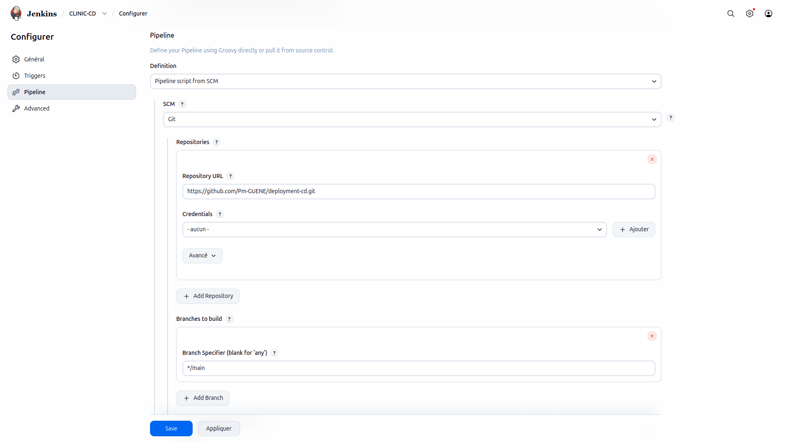

#### 14. Journal de scrutation Git

Le journal Jenkins confirme la détection automatique d'un changement sur la branche `main` du dépôt GitHub.

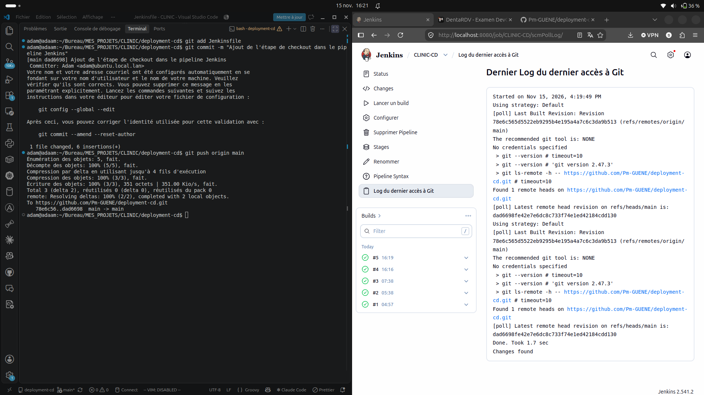

Les captures servent de complément aux configurations et résultats décrits dans ce document. Les secrets et mots de passe ne doivent pas apparaître dans les captures partagées.

---

## 13. Sécurité et bonnes pratiques

Plusieurs précautions doivent être respectées pour maintenir un environnement de déploiement sécurisé.

### Gestion des secrets

- Ne jamais versionner le fichier `.env`.
- Utiliser des credentials Jenkins pour les authentifications.
- Utiliser des Docker Hub Access Tokens plutôt que le mot de passe principal du compte.
- Renouveler régulièrement les secrets sensibles.
- Ne jamais afficher les secrets dans les journaux Jenkins.

### Gestion des données

- Ne jamais supprimer le volume PostgreSQL lors d'un simple redéploiement.
- Effectuer des sauvegardes régulières de la base de données.
- Vérifier périodiquement la possibilité de restaurer les sauvegardes.

### Attention aux commandes Docker

Commande de redémarrage :

```bash
docker compose restart
```

Commande de redéploiement :

```bash
docker compose up -d
```

Commande à utiliser avec une extrême prudence :

```bash
docker compose down -v
```

L'option `-v` supprime les volumes associés au projet et peut entraîner la perte des données PostgreSQL.

### Sécurité du socket Docker

Le montage du socket `/var/run/docker.sock` donne à Jenkins un accès très privilégié au moteur Docker de l'hôte.

Cette configuration est adaptée à l'environnement de travail réalisé, mais elle doit être protégée et réservée à un Jenkins de confiance.

---

## 14. Limites et améliorations possibles

L'environnement CD est fonctionnel. Certaines améliorations pourront être envisagées :

- Utilisation de tags Docker immuables au lieu de dépendre uniquement de `latest`.
- Déclenchement automatique du pipeline CD après une publication réussie des images CI.
- Mise en place de sauvegardes PostgreSQL automatisées.
- Ajout d'une stratégie de retour à la version précédente (rollback).
- Séparation des environnements de développement, de test et de production.
- Mise en place d'un système de surveillance des conteneurs.

Ces améliorations constituent des perspectives d'évolution et ne sont pas présentées comme des fonctionnalités déjà implémentées.

---

## 15. Conclusion

La mise en place de la chaîne de déploiement continu de CLINIC a permis d'automatiser la récupération et le déploiement des images Docker publiées sur Docker Hub.

Grâce à Jenkins, Docker et Docker Compose, les services Backend et Frontend peuvent être mis à jour sans reconstruction locale des images.

L'utilisation d'un volume Docker nommé assure la conservation des données PostgreSQL lors du redémarrage et du remplacement des conteneurs.

Les vérifications réalisées ont confirmé :

- Le bon fonctionnement des trois services.
- La communication entre les composants.
- L'authentification de Jenkins auprès de Docker Hub.
- La récupération des nouvelles images.
- Le succès du déploiement automatisé.
- La persistance effective des données PostgreSQL.

**La chaîne CD de CLINIC est opérationnelle et le premier déploiement automatisé a été validé avec succès.**
